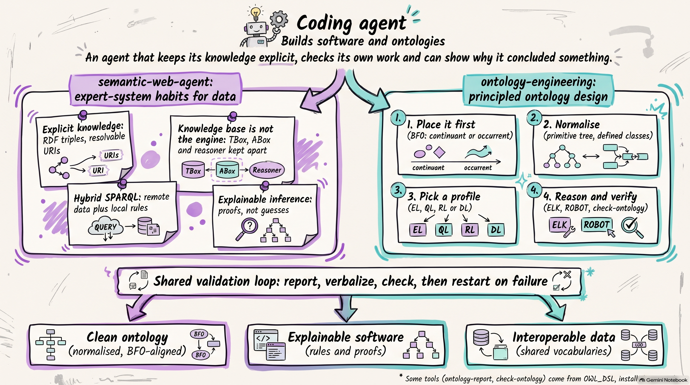

# Semantic Web Agent and Ontology Management Skills

Agent scaffolding that uses principles of Expert systems, Linked Data, ontology engineering, and World Wide Web architecture

Provides two Agent Skills for OpenCode and Claude Code, plus a medical reasoning [subagent](https://opencode.ai/docs/agents/) and
[command](https://opencode.ai/docs/commands) for delegating clinical terminology questions to a terminology specialist model instead of reasoning about unfamiliar medical terms directly.

Is opinionated in which tools to use ([OWL_DSL](https://github.com/chimezie/owl_dsl), [ROBOT](https://robot.obolibrary.org/), [Fuxi-reincarnate](https://github.com/chimezie/fuxi-reincarnate), [riot](https://jena.apache.org/documentation/io/)) but provides a comprehensive Semantic Web architecture toolkit.

## Installation

Run the installer from the repository root. It installs the skills for OpenCode, Claude Code, or both; the default is `--target all --scope user`.

| Goal | Command |
| --- | --- |
| OpenCode only | `tools/setup.sh --target opencode` |
| Claude Code only | `tools/setup.sh --target claude` |
| Both agents | `tools/setup.sh --target all` |
| Project scope | `tools/setup.sh --target all --scope project --project-dir /path/to/project` |
| Development (`--link`) | `tools/setup.sh --target opencode --link` |
| Claude Code agent and command | `tools/setup.sh --target claude --with-agents` |
| Uninstall | `tools/setup.sh --uninstall --target all` (add `--with-agents` to also remove unchanged generated Claude files) |

Preview any run with `--dry-run`; replace installs this script did not create with `--force`.

**Prerequisites.** Bash, plus [uv](https://docs.astral.sh/uv/) to run the bundled helper scripts. The installer warns if `uv` is missing; without it, install `rdflib` and `fuxi` yourself and run the scripts with `python3`.

**Choosing a target.** OpenCode's docs list `~/.claude/skills` among the directories it reads, so `--target claude` alone may serve both agents. `--target all` installs a separate copy for each, and on OpenCode 2.x its own copy takes precedence over the Claude one, so re-run the installer rather than editing one copy by hand. Restart OpenCode (or start a new Claude Code session) after installing so the skills are rediscovered.

**What the installer will not overwrite.** Skill directories carry a marker file and the OpenCode helper scripts and wrappers (copied to `~/.opencode/tools`) are tracked in a manifest in that directory. Anything the script did not install, or that you edited afterwards, is skipped with a warning unless you pass `--force`. The `--uninstall` option only removes what has not been changed. Check that the tools appear after installing.

The OpenCode `medical-concept` agent needs a model. Pass `--opencode-model provider/model`, let the installer prompt on a terminal, or edit the installed agent; without a value it uses OpenCode's default model. Example: `tools/setup.sh --target opencode --opencode-model myprovider/my-model`. Add `--claude-model sonnet` (or a full ID) when generating the Claude agent.

The `semantic-web-agent` skill also uses tools such as `ontology-report`, `verbalize-ontology-class`, and `check-ontology` that come from [OWL_DSL](https://github.com/chimezie/owl_dsl). Install OWL_DSL separately; this repository bundles only the helper scripts under `skills/semantic-web-agent/scripts/`.

## Skills

### 1. [`semantic-web-agent`](skills/semantic-web-agent/SKILL.md)

Handles RDF, OWL, N3, RIF, and SPARQL including entailment regimes. Applies expert system principles to semantic web standards.

* Semantic Web as extension of Web of Data with logic-based Knowledge Representation; Preference for declarative linked data with resolvable URIs.
* Workflows ([`references/workflows.md`](skills/semantic-web-agent/references/workflows.md)):
  * A. Inspection & Review via `pyhornedowl`: `verbalize-ontology-class`, `find-ontology-class` / `find-ontology-property`, `ontology-report`, `check-ontology`, `ontology-measure-essentials`.
  * B. Logical Reasoning via `owlready2`/ELK: `create-ontology`, `class-entailments`, (proof trace), `destroy_sqlite`.
  * C. Hybrid SPARQL (remote EDB + local TBox): `sparql-interlocution` with N3 bridge rules; keep TBox in OWL 2 RL for DLP.
* Guides:
  * [`semantic-web-basics.md`](skills/semantic-web-agent/references/semantic-web-basics.md) : URIs, Turtle/N3/RDF-XML/N-Quads, REST/303, Linked Data
  * [`fuxi-entailment.md`](skills/semantic-web-agent/references/fuxi-entailment.md) : EDB vs IDB, `entailing_graph.query` vs `sparql_interlocution_basic_graph_pattern`
  * [`fuxi-cli.md`](skills/semantic-web-agent/references/fuxi-cli.md) : `fuxi.core`/`proof`/`owl`, `--dlp`, `--hybrid`, `--why`
  * [`ontology-development.md`](skills/semantic-web-agent/references/ontology-development.md) : InfixOWL vs plain `rdflib`, ROBOT merge
  * [`cnl-configuration.md`](skills/semantic-web-agent/references/cnl-configuration.md) : Manchester OWL to CNL rendering
  * [`check-ontology-reference.md`](skills/semantic-web-agent/references/check-ontology-reference.md) : ROBOT report rules and `ontology_db.json`
* Scripts: [`sparql-interlocution.py`](skills/semantic-web-agent/scripts/sparql-interlocution.py), [`create-ontology.py`](skills/semantic-web-agent/scripts/create-ontology.py), [`dir-ontology.py`](skills/semantic-web-agent/scripts/dir-ontology.py), [`list-ontologies.py`](skills/semantic-web-agent/scripts/list-ontologies.py), [`get-annotation.py`](skills/semantic-web-agent/scripts/get-annotation.py) / [`set-annotation.py`](skills/semantic-web-agent/scripts/set-annotation.py)

### 2. [`ontology-engineering`](skills/ontology-engineering/SKILL.md)

Normalizes OWL 2 ontologies via Rector normalisation, BFO alignment (for biomedical ontologies).

* Distinguish **ontological placement** (BFO: continuant/occurrent, independent/dependent) from **implementation normalisation** (primitive vs defined).
* Rector recipe: compositional classes via primitive skeleton trees (single primitive parent, homogeneous subsumption), `EquivalentTo` with existential restrictions (Manchester: `Fracture and (has_location some Femur)`), RO reuse, sibling disjointness, reason, and verify.
* Profile table: DL (general), EL (large TBox/SNOMED, no `ObjectAllValuesFrom`/inverse/cardinality/disjunction), QL (large ABox/SQL rewriting), RL (rule-based scalable).
* Triggers:
  * [`bfo-case-study-patterns.md`](skills/ontology-engineering/references/bfo-case-study-patterns.md) : BFO category placement and modeling change over time
  * [`biomedical-ontology-modeling.md`](skills/ontology-engineering/references/biomedical-ontology-modeling.md) : domain-specific modeling conventions
  * [`reasoning-fundamentals.md`](skills/ontology-engineering/references/reasoning-fundamentals.md) : EL inference rules and proof format
  * [`ontology-lifecycle.md`](skills/ontology-engineering/references/ontology-lifecycle.md) : merge/import practices and verification sequence

## Medical reasoning subagent and command

For use with medical reasoning language models:

* [`agents/medical-concept.md`](agents/medical-concept.md) (`medical-concept` subagent, `temperature: 0.2`, `edit/bash/task: deny`): clinical terminology and coding-system specialist with built-in expertise in ICD-10-CM, FMA, PDGM, OASIS, NANDA-I, and SNOMED CT. Returns short conversational answers with standard definitions only, ICD-10-CM name if defined there, owning terminology system, and synonyms. Delegate terminology disambiguation, coding-system mapping, and clinical semantics questions to it.
* [`commands/ask-medical.md`](commands/ask-medical.md) (`/ask-medical`, `agent: medical-concept`, `subtask: true`): thin wrapper that forwards `$ARGUMENTS` to the subagent.
